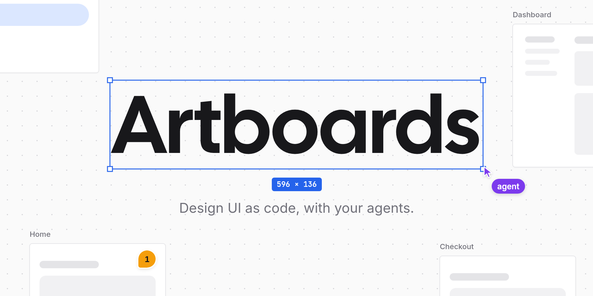

# Artboards

Design UI as code. You write artboards as JSX/TSX components using a set of built-in layers. The CLI
type-checks them, lays them out, reports layout problems, renders PNG screenshots and prints layer
trees. It also opens a browser viewer where people review the designs and leave comments.

It was built for coding agents. An agent can write a design, check it with `lint`, look at it with
`render`, and fix whatever a reviewer commented on.

The [website](https://artboards.cy4n.dev), is itself a design made with [artboards](examples/artboards/site.tsx)!

```tsx
import { Column, Frame, Row, Text } from "artboards";

export function Home() {
  return (
    <Frame width={390} height={844} fill="#ffffff">
      <Column width="fill" height="fill" padding={16} gap={12} align="stretch">
        <Text fontSize={24} fontWeight={700}>Title</Text>
        <Row height={44} padding={[0, 12]} align="center" fill="#f3f4f6" cornerRadius={8}>
          <Text>Label</Text>
        </Row>
      </Column>
    </Frame>
  );
}
```

How it works:

- Layout uses flexbox and grid ([Taffy](https://github.com/DioxusLabs/taffy)) and rendering uses Skia
  ([CanvasKit](https://skia.org/docs/user/modules/canvaskit/)), so a PNG from the CLI looks the same as the
  design in the browser viewer.
- Every exported component in the file you pass is one artboard. Components you don't export are
  reusable pieces. A design can be split across several files with relative imports.
- `useVariant` declares the states a reviewer should be able to switch between, such as loading, empty,
  error or the steps of a flow. `onClick` handlers make a prototype that runs in the viewer's Play mode.
- Fonts (Inter, Noto Sans SC, Fraunces, JetBrains Mono) are bundled. Local images and font files can be
  imported.

## Requirements

- Node.js 24 or later

## Install

```bash
npm install -g artboards-design
```

Check that it worked:

```bash
artboards --version
```

To run it without a global install, use `npx -p artboards-design artboards <command>` wherever these docs
say `artboards`.

A design project needs no setup of its own. It has no `package.json`, no `tsconfig.json` and no
`node_modules`. A design file imports from `"artboards"`, and the CLI supplies that module and its types.
The only other imports allowed are relative files: code (`.jsx`, `.tsx`, `.ts`, `.js`), images and fonts.

## Usage

Save the example above as `design.tsx`, then you can run the following commands on the design file:

| Command | What it does |
|---|---|
| `lint <file> [--variant name=value] [--json]` | Type-checks the file, renders every artboard and reports layout problems such as overflow or clipped text. Exits with 1 when there are errors. |
| `render <file> [-f Name] [--variant name=value] [-s 2] [-o out.png] [--transparent]` | Writes PNG screenshots. The default path is `out/<file>.<Artboard>.png`. Artboards sit on white, as in the viewer, unless `--transparent`. |
| `inspect <file> [-f Name] [--variant name=value] [--json]` | Prints each artboard's layer tree with its position, size, source line and variants. |
| `dev <file> [-p 4400] [--host 127.0.0.1]` | Starts the browser viewer, which reloads on every save. Reviewers can inspect layers, switch variants, try Play mode (P) and comment. Keeps running until stopped. |
| `build <file> [-o dir]` | Writes the viewer and the design as a static site (default: `out/<file>/`) for reviewers who don't have the CLI. |
| `comments <file> [--all] [--resolve id] [--import file] [--json]` | Lists open review comments, each with the source line of the layer it is on. `--resolve` marks one as done. `--import` adds comments exported from a `build` site. |
| `docs` | Prints the full DSL reference: the guide plus the TypeScript API. |

Run `artboards <command> --help` for every option.

### Reviewing a design

1. Run `artboards dev design.tsx` and open the URL. Comments made in the viewer are saved to
   `design.comments.json`, next to the design file. For reviewers who don't have the CLI, run
   `artboards build design.tsx` to build the design as a static site. Their comments stay in
   their browser until they export them.
2. Run `artboards comments design.tsx` to list what needs doing. Fix each item, then run
   `artboards comments design.tsx --resolve <id>`. Import the exported comments with
   `artboards comments design.tsx --import design.comments.json`.

## Using it with a coding agent

The agent works through the CLI. It needs `artboards` on its PATH (see [Install](#install)) and the DSL
reference. There is no plugin or server to set up.

1. **Give the agent the reference.** `artboards docs` prints everything an agent needs to write valid
   designs: sizing and layout rules, text, images and fonts, variants, interactions, what doesn't exist
   in the DSL, and the full typed API. Tell the agent to read it before writing a design.
2. **Add instructions to the design project.** Copy the block below into the project's `AGENTS.md`,
   `CLAUDE.md` or the equivalent file for your agent.
3. **Run the viewer yourself.** `artboards dev <file>` keeps running, so start it in your own terminal,
   not the agent's. Review and comment in the browser, then ask the agent to address the comments.

```markdown
## Designing with Artboards

UI designs in this project are JSX/TSX files written in the Artboards DSL.

- Before writing or editing a design, run `artboards docs` and read all of it. The DSL is not HTML,
  CSS or React Native. Use only the elements and props it documents.
- Every exported component of the design file is one artboard. Import only from "artboards" and
  from relative files.
- After every edit, run `artboards lint <file>` and fix every error and warning before moving on.
- To see the result, run `artboards render <file> --frame <Name> --scale 2` and open the PNG.
  Use `artboards inspect <file> --frame <Name>` for exact positions, sizes and source lines.
- Put each state a reviewer should see (loading, empty, error, a step of a flow) in a variant with
  `useVariant`. Check it with `--variant Name=value` on lint, render and inspect.
- When asked to address review feedback, run `artboards comments <file>`, fix each comment at the
  source line it gives, then run `artboards comments <file> --resolve <id>`.
- Don't run `artboards dev`. It keeps running, and the human runs it to review.
- `lint`, `inspect` and `comments` take `--json` for structured output.
```

## Development

Building from source needs [pnpm](https://pnpm.io/) as well as Node.js.

Source layout:

- `src/cli/`: the CLI and dev server
- `src/viewer/`: the browser viewer
- `src/shared/`: the DSL, layout, painting and lint rules, used by both the CLI and the viewer
- `src/docs/`: the guide and declarations template that `artboards docs` is built from
- `examples/artboards/`: the project's own images and website, designed with artboards

## License

[MIT](LICENSE)
